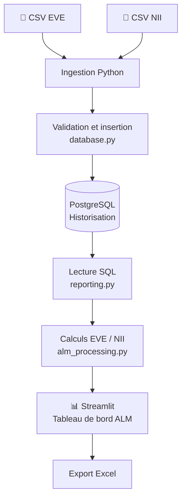

# DataStream ALM

DataStream ALM est un projet personnel Python développé
autour du traitement et du reporting d'indicateurs
de risques financiers.

L'objectif est de simuler l'évolution d'un outil de
reporting bancaire : collecter des données, les contrôler,
les historiser puis les restituer dans une interface web.

## Fonctionnalités

- Ingestion de fichiers CSV EVE et NII
- Validation des données et détection des doublons
- Traitement des indicateurs avec Pandas
- Stockage et historisation dans PostgreSQL
- Calcul des variations sous choc de taux
- Dashboard interactif avec Streamlit
- Filtres par indicateur, entité et période
- Export des reportings au format Excel

## Technologies

Python, Pandas, NumPy, PostgreSQL, SQLAlchemy,
Streamlit, Plotly et pytest.

## Organisation du projet

- `src/ingestion.py` : collecte et validation
- `src/alm_processing.py` : calculs financiers
- `src/models.py` : modèles de données
- `src/database.py` : persistance PostgreSQL
- `src/reporting.py` : extraction et reporting
- `app.py` : interface web Streamlit
- `tests/` : tests automatisés

## Exécution

1. Installer les dépendances :
   `python -m pip install -r requirements.txt`

2. Créer une base PostgreSQL `datastream_alm`.

3. Configurer `DATABASE_URL` dans un fichier `.env`
   à partir de `.env.example`.

4. Importer les données :
   `python -m src.database`

5. Démarrer l'application :
   `python -m streamlit run app.py`

Pour exécuter les tests :
`python -m pytest tests/ -v`

## Données

Le projet utilise exclusivement des données financières
fictives. Il ne reproduit pas un système bancaire réel
ni une méthodologie réglementaire complète.

## Contexte

Ce projet m'a permis de travailler sur une chaîne
complète de traitement de données, depuis les fichiers
sources jusqu'à leur restitution dans une application web,
avec une attention particulière portée à la qualité
des données et à la réutilisabilité du code.

## Architecture du projet

DataStream ALM suit une architecture simple : les données
sont collectées, contrôlées et stockées dans PostgreSQL,
puis exploitées pour produire des reportings interactifs.

